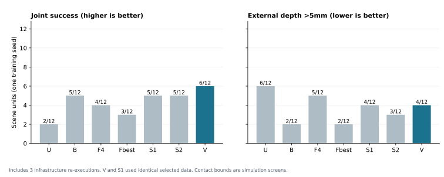

# HandBack: A Bounded Study of Learning-Value-Based Control Handback

Exploratory technical report · Version 0.1.0 · 23 October 2026

## Abstract

After a teacher corrects a robot, immediate ability to resume and usefulness of further teaching are different objectives. We tested whether a selector that estimates future learning benefit adds value beyond a visual–action support rule. The study used one Piper manipulation task, six teacher parent states, seven methods, one training seed, and twelve paired evaluation scenes per method. The learning-value method achieved joint success in 6/12 completed evaluation units versus 5/12 for each support baseline. It failed the predeclared improvement and deep-contact screening gates. More importantly, it selected exactly the same teacher prefixes and training treatment as the first-support baseline. The observed score difference therefore does not identify a learning-value selection effect. Original-attempt bounds also fail the screening gates without substituting infrastructure retries. We release selection primitives, per-scene derived evidence, audit summaries, and executable analysis; the larger experiment was not run.

## 1. Question and relation to prior work

The question is narrow: **does choosing when to end a correction segment according to expected post-update benefit improve later autonomous performance beyond choosing by current support?**

Bidirectional intervention and corrective supervision already appear in [AutoIntervene](https://arxiv.org/abs/2608.07065). Allocation of recovery-training effort according to expected task improvement appears in [MetaReSkill](https://arxiv.org/abs/2209.13605). Our candidate combines a common support gate with prediction of stop-versus-continue learning benefit for prefixes of the *same* correction segment. This report neither establishes priority for that combination nor reproduces those papers' original robot experiments. It tests a local candidate implementation.

## 2. Executed design

| Component | Setting |
|---|---|
| Task | `red_objects_in_basket`: place red targets in the basket while satisfying the task's other conditions |
| Environment | Guava, MuJoCo, author robosuite fork, Piper model/control adapters; fixed camera and tool contract across methods |
| Starting student | Existing Qwen3.5-4B SFT `checkpoint-99`; **not** an untrained Qwen baseline |
| Correction library | Six usable nonterminal parent states from 24 acquisition attempts; real teacher prefixes of 1, 2, or 4 actions |
| Value development | 18 single-parent/prefix updates and matched replay controls; 88 development executions |
| Final update | Six methods ×24 LoRA optimizer steps; seed 42, rank 8, alpha 16, q/v/o projections, learning rate 1e-4; vision frozen |
| Replay | Two common old targets per correction target; replay-only uses three old targets |
| New-scene evaluation | Seven methods ×12 paired initial states; no teacher during these executions |
| Runtime limits | Official task budget: 25 decisions; existing 30 cumulative tool-action cap; maximum output 2,048 tokens |

The four-step teacher library was collected in full before selection. All of its acquisition cost is charged. This is causal-prefix selection **over an already paid library**, followed by actual parameter updates and autonomous evaluation; it is not a newly executed online teacher handoff study.

V uses fixed-L2 stop/continue regressions fitted out of fold: each parent is selected using the other five parents' development outcomes. The ten current-prefix features contain teacher count, remaining decision budget, past tool feedback, past teacher-target NLL, and last-tool categories. Parent IDs and simulator truth are not prediction features. Future outcomes are training labels only. The selector accesses checkpoints 1/2/4 sequentially and stops accessing prefixes after returning.

S1, S2 and V share the calibrated visual–action support gate. S1 returns at the first acceptance; S2 requires two consecutive **scheduled** acceptances. V additionally requires predicted stopping value ≥ continuing value. If no handoff is declared, all four correction targets remain in training: abstention is not a hidden data-filtering advantage. Fixed-1 is chosen on development data, not the twelve evaluation scenes. Optimizer steps are matched; exact FLOPs are not claimed equal.

The protocol and identification amendment were frozen before the new evaluation scenes were consumed. They were not externally preregistered. [Original protocol](protocol/07_prospective_validation_protocol.md), [amendment](protocol/08_identification_amendment.md).

## 3. Main results

“Complete + held” requires the original task predicate, a literal `Task complete.` response, and ten registered holds. The primary joint metric additionally requires maximum external robot contact depth ≤2mm over the registered control interval. Extra audit-only holds are reported separately. The 2mm threshold is an engineering simulation screen, not a real-robot safety limit. The >5mm count covers **all** trajectories, not only successful ones.

| Method | Original predicate | Complete + held | Joint ≤2mm | >5mm contact |
|---|---:|---:|---:|---:|
| U: no further update | 9/12 | 5/12 | 2/12 | 6/12 |
| B: replay only | 10/12 | 9/12 | 5/12 | 2/12 |
| F4: fixed four steps | 10/12 | 7/12 | 4/12 | 5/12 |
| Fbest: development-selected fixed one step | 8/12 | 5/12 | 3/12 | 2/12 |
| S1: first support acceptance | 11/12 | 8/12 | 5/12 | 4/12 |
| S2: two scheduled support acceptances | 10/12 | 8/12 | 5/12 | 3/12 |
| V: learning-value exit | 10/12 | 8/12 | 6/12 | 4/12 |

This completed table includes three infrastructure re-executions. The screening gate required V to exceed **each** of Fbest, S1 and S2 by at least two joint successes, and to have no more >5mm trajectories than Fbest. Actual differences were +3/+1/+1, and V had four deep-contact trajectories versus Fbest's two. Both gates failed. Stage B, additional training seeds, and the paper-scale experiment were not executed. No significance test or population-level superiority claim is made. The released table also includes 1mm and 5mm sensitivity outcomes.

## 4. Identification check: the added selector did not change the treatment

| Method | Retained teacher steps across the six parents | Handoffs |
|---|---|---:|
| F4 | 4, 4, 4, 4, 4, 4 | 6 |
| Fbest | 1, 1, 1, 1, 1, 1 | 6 |
| S1 | 1, 1, 1, 4, 1, 1 | 5 |
| S2 | 4, 4, 2, 4, 4, 2 | 2 |
| V | **1, 1, 1, 4, 1, 1** | **5** |

The retained four-step parent without handoff is kept for training. V and S1 have identical targets, order, replay, and hyperparameters; their realized schedule hashes match. Saved weight tensors nevertheless differ numerically. Initial adapter tensors and encoded-input byte fingerprints were not captured, so the cause of the numerical divergence is unresolved. It must not be confidently attributed to initialization, GPU nondeterminism, or a particular bug.

Thus the 6-versus-5 outcome difference cannot establish the proposed **selection** mechanism's benefit. This is a more fundamental limitation than small sample size. It does not prove V and S1 are globally identical policies.

## 5. Immediate returnability and interrupted attempts

Immediate continuation is assessed separately by reusing 18 prior real same-state executions. These are not new trials and overlap across methods.

| Method | Handoffs | Complete + held after handoff | Joint ≤2mm after handoff | No handoff |
|---|---:|---:|---:|---:|
| F4 | 6 | 3/6 | 2/6 | 0 |
| Fbest | 6 | 2/6 | 1/6 | 0 |
| S1 | 5 | 2/5 | 1/5 | 1 |
| S2 | 2 | 1/2 | 1/2 | 4 |
| V | 5 | 2/5 | 1/5 | 1 |

Support acceptance is not a guarantee of full-task returnability.

The original 40-minute worker lease interrupted V/4004; fail-fast cleanup also stopped S1/4007 and S1/4011. An isolated revision retained 69 completed records, including failures, reran only those three fixed units, and executed the twelve originally unstarted units. The infrastructure lease became 90 minutes; task budgets, weights and control stayed unchanged. There are 84 logical units but **87 actual attempt directories**, including three preserved partials. Matching initial inputs does not make these exact continuations: later actions sometimes diverged.

| Method | Completed-table joint successes | Original-attempt joint bounds |
|---|---:|---:|
| Fbest | 3/12 | 3–3/12 |
| S1 | 5/12 | 4–5/12 |
| S2 | 5/12 | 5–5/12 |
| V | 6/12 | **5–5/12** |

V/4004 had already reached 10.715mm contact depth before interruption, so its original primary failure cannot be reversed by a missing tail. Original V deep-contact count is five versus Fbest's two. Even favorable assignment of unresolved outcomes cannot pass the gates. These are missing-outcome bounds, not confidence intervals. [Infrastructure amendment](protocol/11_infrastructure_resumption_v3.md).

## 6. Physical evidence, cost and limitations

Offline review recomputed 84 contact traces and independently reconstructed 84 task predicates from logged poses and contacts. Initial states/first inputs were paired; actual compiled models were byte-identical across methods for each scene. Original closure checks covered 3,679 source/asset entries, 2,432 artifact hashes and 1,844 unique native image paths. These checks establish artifact consistency, not successful execution of every task or external replication.

Six saved CAD states were examined. Four deep palm-contact cases had sampled interior overlap between robot CAD and object collision convex hulls; a low-depth palm case had no sampled overlap but does not prove zero overlap. A low-depth link7 case used an open visual mesh and could not support reliable signed-volume certification. No geometric repair was deployed or credited as an algorithm improvement. Final images were internally inspected but gripper occlusion/stacking prevented blanket visual approval; derived peak views were not native frames and were not pixel-aligned certificates.

| Work item | Recorded amount |
|---|---:|
| Teacher acquisition | 24 attempts; 85 responses; 1,293.13s summed full-client request time |
| Development training | 20 jobs; 100 optimizer steps |
| Development execution | 88 rollouts |
| Reused immediate-return probes | 18 executions |
| Final pooled training | 6 methods ×24 =144 optimizer steps |
| Final evaluation including partials | 1,885 student requests; 9,740.73s summed client request time |

Inner teacher-provider time (1,113.83s) is nested inside the outer client measurement, not additive. Summed request time is not parallel wall time. Full teacher acquisition was already paid; **online API savings were not measured**. GPU-energy, dollar cost, and unlogged idle/loading costs are not estimated.

The study has one task, six parents, one training seed, twelve scene units per method, infrastructure deviations, and imperfect simulation geometry. It provides no evidence about broad task generalization, hardware safety, or sustained online learning. The negative feasibility decision is bounded to this implementation and protocol, not a proof that control-handback learning cannot work.

## 7. What is released

The public package contains per-scene derived outcomes (including failures), original-attempt bounds, selector features/models/traces, training-treatment fingerprints, contact and predicate audit records, cost summaries, protocol amendments, and computation primitives used for selection/contact analysis. The project page adds all 84 final-observation crops, three labelled discrete-observation replays, and two derived pose diagnostics. Replays are not continuous motion footage. A versioned media-source archive preserves selected original simulation observations and review panels. Private storage roots are replaced by stable artifact identifiers; original and exported hashes are recorded. Credentials, real-robot photographs, private server addresses, upstream mesh/asset bundles, executable pickles, full raw trajectory archives and checkpoint weights are excluded. [Media provenance](media.md).

`python -m handback.analysis` replays selection from released features, regenerates tables, checks audit consistency and verifies the stopping decision. It does **not** recreate training or integrate the simulator. Hashes of unavailable artifacts prove neither their public availability nor their contents. [Reproduction scope](reproduction.md) · [Data card](../data/README.md).

The practical result is to stop expansion of the current candidate. A future study would first need an observable decision disagreement from a strong baseline and an independently attributable benefit, rather than more evaluation samples of the same realized treatment.

## References

1. Tang, J. and Zhi, W. *AutoIntervene: Calibrated Intervention for Action-Chunking Imitation Learning Policies*. [arXiv:2608.07065](https://arxiv.org/abs/2608.07065).
2. Vats, S., Likhachev, M. and Kroemer, O. *Efficient Recovery Learning using Model Predictive Meta-Reasoning*. [arXiv:2209.13605](https://arxiv.org/abs/2209.13605).
3. Guava source/configuration reference, fixed commit `8eeed908bef4fb63c8bfc7c4e2fa2f5684eb067f`. [Source](https://github.com/hdacnw/guava-release/tree/8eeed908bef4fb63c8bfc7c4e2fa2f5684eb067f). Piper control adaptation and tool arguments are explicit departures from the original robot setup.
